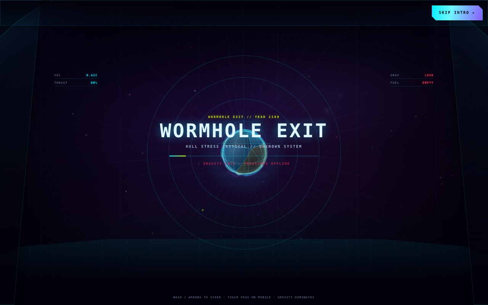
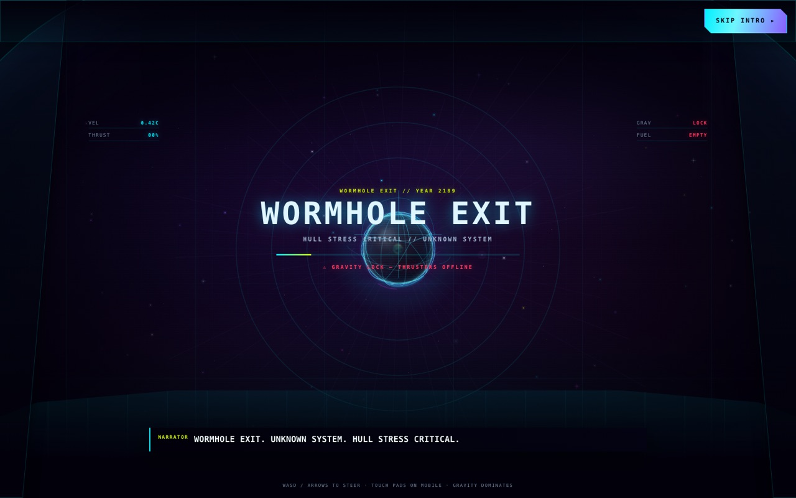
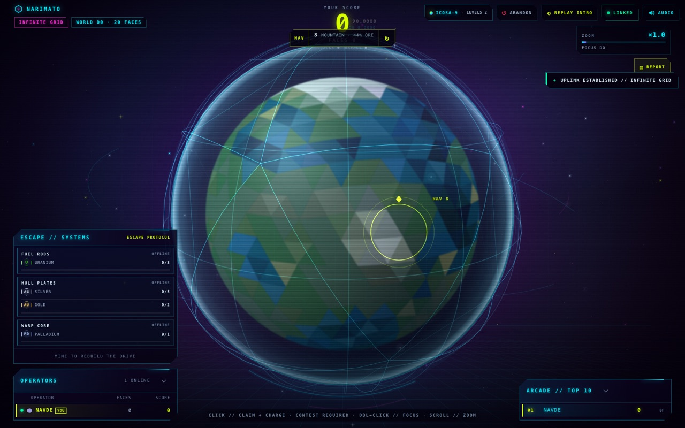
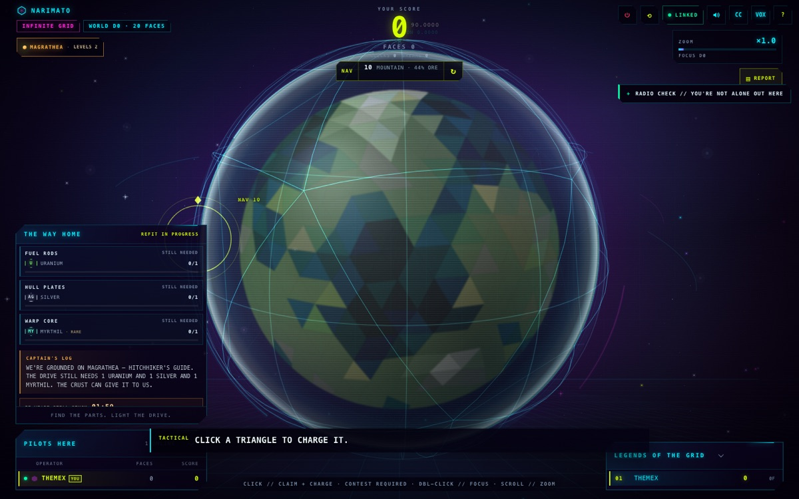
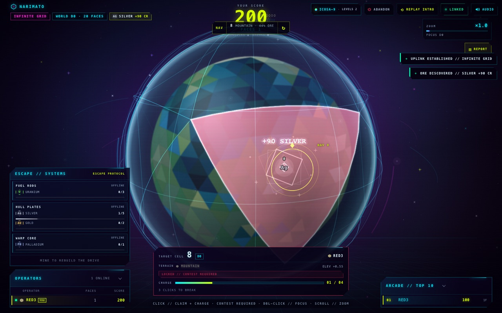

# NARIMATO


> **YEAR 2189. A wormhole throws your damaged ship to the far side of the universe.**
> You wake inside the cockpit above **MAGRATHEA**, gravity-locked with empty tanks.
> Mine the crust, rebuild the drive, escape — and find the way home. Every escape throws you
> through a new story onto a new, deeper planet with its own multiplayer battlefield.

**NARIMATO** is a persistent multiplayer browser game on a spherical icosahedron. No installs,
no accounts, no build step and no third-party runtime assets: join with a callsign and start mining.



## Play

```bash
npm start          # Node >= 20, zero dependencies
```

Open **http://localhost:4173** (LAN URL is printed on boot).

**Live:** https://treasurer-record-flooring-mounting.trycloudflare.com

### Controls

| Input | Action |
|---|---|
| **WASD / arrow keys / touch pads** | steer the cockpit during the wormhole intro |
| **Click / tap** a triangle | claim, steal or reinforce it and charge it |
| **Drag** | rotate the planet |
| **Wheel / pinch** | zoom from space to street level |
| **Double-click** | focus/drill into a cell |
| **L** | toggle all face ids (debug) |
| **REPORT** | session summary, downloadable PNG + share link |
| **ABANDON** | confirm and return to the main/tag screen |
| **NEW PILOT** (main screen) | clear this browser's saved pilot and start a new mission |
| **ESCAPE // BURN FOR ORBIT** | leave the planet once the refit is complete |

## The loop

1. **Launch cine** — every page load starts in the cockpit: wormhole exit, gravity lock,
   steerable descent, planet reveal. Skippable and replayable; it also acts as the loading screen.
2. **Tag in** — pick a callsign on the main screen. Each callsign is its own persistent identity
   with its own colour, score and planet progress.
3. **Mine** — charge triangles; a triangle individually breaks into four smaller spherical
   children at **4 clicks on the first planet** (8 on later planets). Hidden ore veins are mined on
   the first successful click and marked forever.
4. **Rebuild the drive** — the escape mission asks for specific ores; the HUD tracks every find.
5. **Escape** — when the refit is complete, burn for orbit. A random deep-space event (storm,
   pirates, wormhole tremor…) damages the ship and forces a landing on the **next planet**.
6. **Repeat forever** — planet 1 has **2 levels = 20 + 80 triangles**, planet 2 has **3 levels =
   20 + 80 + 320**, and so on up to the level cap. The first planet is a short tutorial with
   guaranteed refit ore; later planets are larger. Each planet is its own multiplayer scene with
   its own players, robots, leaderboard and grid.

Each planet has finite hidden deposits. When the planet is fully mined out, a **meteor impact**
resets its crust and releases new resources. The game never ends.

## Documentation

- **[Delivery SSOT](docs/SSOT.md)** — how work is planned, tracked and proven.
  The board is the single delivery source of truth:
  [NARIMATO delivery board](https://github.com/users/moldovancsaba/projects/80) ·
  [issue index and doc map](docs/ISSUE_MAP.md) ·
  [Definition of Done](docs/DEFINITION_OF_DONE.md).
- [Gameplay guide](GAMEPLAY.md) — story, mission, planets, controls, tips.
- [Architecture](ARCHITECTURE.md) — stack, modules, protocols, data model, algorithms.
- [Release notes](RELEASE_NOTES.md) — what shipped in this release and migration notes.
- [Planet generation research](PLANET_RESEARCH.md) — low-data procedural surface sources/algorithm.
- [Algorithm notes](ALGORITHM.md) — spherical geometry, labels, picking, zoom math.
- [Architecture decisions](docs/adr/README.md) — ADRs for runtime dependencies, GDS boundary, single scene, authority and persistence.
- [Test map](docs/TEST_MAP.md) — which test file owns which behaviour and issue.
- [Protocol/feature specs](SPEC_INFINITE.md) · [resources](SPEC_RESOURCES.md) ·
  [planet surface](SPEC_PLANET.md) · [planet progression](SPEC_PLANETS.md).

## Features at a glance

- **Persistent spherical world** — adaptive four-way geodesic subdivision, stable hierarchical
  labels (`11.4`, `9.2.1.1`), individual per-cell breaking, infinite zoom.
- **Authoritative multiplayer** — Node server, SSE rooms per planet, robots on every planet,
  per-cell contest locks, atomic persistence, graceful restart recovery; server-owned surface
  poses for every human and robot (validation, rate-limit, 5 s expiry), seeded robot routes and
  server-side emergency-supply relocation.
- **Detailed procedural geography** — a high-detail seeded terrain layer (continents, oceans,
  coasts, mountains, polar ice) renders behind the gameplay cells, so you see the planet surface
  through the grid. One 32-bit seed, no textures/heightmaps; resources follow the same geology.
- **10 minerals** — silver → neutronium, hidden deposits, underwater deposits inaccessible.
- **Escape progression** — per-planet levels and scaled refit missions, a centered
  **TRY TO FLY AWAY** call-to-action when the drive is ready, random interplanetary story
  cinematics, screen shake/damage, separate multiplayer scene for every planet.
- **Planetary incidents with consequences** — every catastrophe explains what happened and why new
  resources are now available; the Captain’s Log keeps the story after the overlay disappears.
- **Planetary incidents** — exhausted planets now end with one of four random catastrophes:
  **Meteor Impact**, **Nuclear War**, **Solar Flare** or **Alien Invasion**, each with its own
  full-screen effect, narration and reseeded crust, then fresh resources.
- **Responsive command deck** — deliberately different desktop, tablet, mobile portrait and
  landscape phone layouts; mobile is planet-first with drawers/dock/target sheet.
- **Stable direct camera** — mouse drag follows the cursor; release leaves the planet exactly where
  you left it. Arrow keys travel the other way (cursor left rotates the planet right). Wheel/pinch
  zoom eases into its target instead of snapping.
- **Narration & subtitles** — slow, deliberate prerecorded voice-over delivered **one sentence at
  a time**, with a short pause between lines, for the story, tips, Field Manual, every
  interplanetary story, emergency relief drops, all four catastrophes, the Quick Guide and the
  Captain's Log (40 cues, 115 sentence units per voice). **VOICE** and **CC** toggle
  independently and remember your choice; subtitles work even when autoplay blocks the first
  audio line.
- **Three narrator voices** — open-source **GEORGE** (Kokoro-82M, default), British **DANIEL** or US
  **SAMANTHA**, selectable in the Field Manual. See [VOICE.md](VOICE.md) for the voice pipeline and
  open-source TTS options (Kokoro, Piper).
- **Narration load management** — first sentences are idle-prefetched with limited concurrency,
  the next sentence is warmed while the current one plays, and voice assets carry a
  content-derived version (`<package version>+<content hash8>`) served immutably, so sentence
  transitions do not stall and a replaced clip is never stale.
- **One copy contract** — `public/js/story-copy.js` renders the Quick Guide, Field Manual,
  incident copy and Captain's Log; marked blocks keep `GUIDE.md` and `GAMEPLAY.md` in sync, with a
  `copy:check` gate that fails CI on drift. See [GUIDE.md](GUIDE.md), [GAMEPLAY.md](GAMEPLAY.md).
- **Field Manual** — an in-game guide to the story, mining, contest lock, planets, navigation and
  controls, with a PLAY button on each section.
- **Contextual tips** — one-time narrated hints for first mining, red locked cells, ore discovery,
  escape readiness, new planets and meteor resets.
- **Navigation target** — a gold **NAV** beacon and chip point to the best nearby geological cell
  to mine; tap the chip to fly the camera there or ↻ to cycle targets.
- **Red locked cells** — a cell you just mined turns red until another operator contests it; then
  it clears and you can mine again.
- **Observable by default** — `GET /api/metrics` exposes privacy-safe HTTP/SSE/planet/event-loop
  metrics, and a tiny client beacon reports Web Vitals/audio-start timing. No tokens or tags.
- **Separate mouse and cursor navigation** — mouse drag follows the cursor directly; arrow keys
  travel around the planet in the opposite direction (cursor left rotates the planet right), in a
  naturally eased upright orbit. Shift speeds up travel; `I` reverses mouse drag.
  Audio resumes after tab interruptions and transient play failures rather than going silent.
- **Limitless trackball rotation** — a quaternion camera replaces the clamped yaw/pitch orbit, so the
  view can roll past both poles and keep going in every direction.
- **Level zoom ladder** — wheel/pinch steps through cell-depth zoom rungs (D0, D1, D2…) with a fast
  cubic-bezier settle. Clicking/fracturing a cell automatically moves the camera to that action level.
- **Quick Guide** — a first-run, shareable one-screen card explains what to mine, how to
  mine, where to dig and how to leave; press **GUIDE** or open `?guide=1`.
- **Surface mode** — scroll past the deepest zoom to land the ship, then run a tiny planet in
  third person. Same active cells/terrain/owner palette as orbit; only the target cell gets
  green/red harvest treatment (GREEN TARGET = harvest, RED TARGET = locked). One lap is **60 seconds**. The view draws only live cell triangles (no generated
  geography) over an opaque low-poly planet shell, so the far side never shows through. Large
  cells are adaptively subdivided along the sphere into small arc triangles. Running is seamless
  across both poles; the heading is parallel-transported instead of rebuilt from east/north.
  Surface entry happens after the fourth zoom rung, the orbital HUD is hidden, and every online
  pilot/robot is drawn walking the same surface with the same avatar system. Remote opponents move
  around fixed independent home orbits — never around the local player. Surface HUD is center-safe
  with a central NEED summary and a bottom RETURN TO ORBIT; returning restores maximum orbit zoom-out.
  Only the target cell and known relief drops get pins; already-mined discovered resources no
  longer clutter the surface. Cyan cell edges match orbit, green/red target state is explicit, and
  remote robots visibly mine with their own beams. Cells keep the same
  terrain/owner palette as orbit; green/red is used only on the cell boundaries as the harvest
  affordance.
  **GREEN** triangles can be harvested, **RED** means locked/empty. The **WHAT SHE NEEDS** panel
  lists the remaining refit parts. A wider footprint harvests every cell touched by the avatar’s
  feet, and harvests show a ship tractor beam, particles and resource value. Press **RETURN TO
  ORBIT** or Escape to leave.
- **Five-tetrahedron ships** — one shared low-poly ship appears in the load-in, interplanetary
  transit, relief drops and alien invasion. Every object is triangle-faced; the solar flare now has
  a visibly faceted sun.
- **Always-contested cells** — the contest lock is always enforced. You cannot farm the same
  cell repeatedly; a robot operator is spawned beside you and prioritises the cell locked to
  you so it can contest it.
- **Manual zoom only** — clicking or breaking no longer changes zoom. Zoom happens only with
  mouse wheel, pinch, double-click focus or the explicit NAV focus control.
- **Stable mouse drag** — mouse rotation uses an absolute arcball grab, so the planet follows
  the cursor consistently through the whole drag, even when the planet is upside down.
- **Gentle early rare budgets** — early planets demand one rare unit, then ramp up with depth.
- **Captain's Log & humanised ship UI** — the panel tells the pilot a short story, names what is
  still missing in plain language, and shows a relief-ship countdown instead of a bare systems list.
- **Emergency supply drop** — if you make no refit progress for two minutes, a relief ship crashes
  onto the planet and scatters the missing ore across nearby triangles; those deposits are mineable
  on the first successful click. Every human on the planet gets the marked cells and the camera
  turns toward the impact, so the salvage race starts together. The beacon repeats every two-minute
  stuck window until the parts are found.
- **Rare refit parts** — every planet now requires at least one rare material (iridium, voidglass,
  myrthil, aetherium, adamantium or neutronium), marked **RARE** in the refit list.
- **Planet major colours** — eight palette identities tint the surface, atmosphere, HUD identity and
  landing briefing, so neighbouring worlds feel like different places.
- **CDN-ready assets** — narration URLs can move to an edge cache with `ASSET_BASE_URL`; audio is
  versioned and immutable. Activation is a credential-gated deployment step, not a shipped claim:
  [docs/CDN_ACTIVATION.md](docs/CDN_ACTIVATION.md).
- **Accessibility + resilience gates** — Chromium/WebKit UI audits, axe-core WCAG checks, 44 px
  touch targets, and a chaos restart test for live SSE/state survival.
- **Mobile-first controls** — labelled 44 px media controls, a visible "tap for voice" hint, and a
  two-column short-landscape landing screen that keeps JACK IN on-screen.
- **Procedural refit missions** — every planet generates its own requirements from its seed. Planet 1
  starts minimal (3 units); each deeper planet grows the refit by 0–3 units and mixes in different
  materials, so no two planets ask for the same cargo.
- **Full cargo inventory** — the HUD shows every collected material, including surplus beyond the
  current refit needs. Everything travels with you to the next planet.
- **Random destinations** — an escape sends you to one of the next **five** planets chosen at random,
  never backwards, each with its own mission and scene.
- **A galaxy of borrowed worlds** — planet names are drawn from a curated cultural catalog
  (*Hitchhiker's Guide*, Star Wars, Marvel, DC, Dune, Doctor Who, Star Trek, Alien, Avatar,
  Foundation, Transformers, classic myth and more) with the source shown in the landing briefing
  and planet tooltip.
- **Random discovery clicks** — each hidden deposit is found on a random successful click (first,
  middle or the break/last click), not always on the very first click.
- **First-planet briefing** — the centered "collect to leave" list now appears on the very first
  planet too, not only after interplanetary landings.
- **Dynamic staffing** — every active planet keeps **3 players online**: 1 human + 2 robots,
  2 humans + 1 robot, or 3+ humans and no robots; replacements spawn immediately.
- **Landing briefing** — touching down on a new planet opens a centered card listing exactly which
  ores are needed to leave, with collected/required counts.
- **Reports & sharing** — 1200×630 session card, shareable URL, all stats persisted.
- **Zero runtime dependencies**, all UI/audio/visuals generated in code.

## Spherical reference viewer

- **`/icosahedron.html`** — isolated reference viewer for the single 20-face spherical icosahedron.
- **Mouse drag rotates the object**; the grabbed surface point follows the cursor exactly.
- **Cursor keys move the camera carrier** on a hidden concentric sphere: local Up/Down/Left/Right,
  infinite over the poles, no clamp.
- **Wheel/pinch changes the carrier radius** with a fixed focal length (real dolly, not optical zoom).
- **WebGL ray–sphere shader** renders the front surface only; analytic icosahedron edges, no hidden
  back faces/edges, no stars/halo/HUD.
- Rationale, failure history and acceptance numbers: [narimato-physics.md](narimato-physics.md).

## Delivery & roadmap

Delivery state, sequencing, dependencies and evidence live on the
**[NARIMATO delivery board](https://github.com/users/moldovancsaba/projects/80)** — not in
repository status documents. The repository owns durable technical knowledge and links its issues:

- [docs/SSOT.md](docs/SSOT.md) — two-source delivery model and non-negotiable rules.
- [docs/ISSUE_MAP.md](docs/ISSUE_MAP.md) — every issue and the documents it relates to.
- [docs/DEFINITION_OF_DONE.md](docs/DEFINITION_OF_DONE.md) — the only definition of done.
- [docs/SHARDING_DECISION.md](docs/SHARDING_DECISION.md) — measured scale headroom, numeric
  sharding triggers, evidence gate, migration and rollback.
- [narimato-physics.md](narimato-physics.md) — authoritative camera/rendering solution, failure
  history and acceptance tests.
- [GUIDE.md](GUIDE.md) — shareable new-pilot guide.
- [GAMEPLAY.md](GAMEPLAY.md) — controls, missions, surface mode and incidents.
- [A11Y_CHECKLIST.md](A11Y_CHECKLIST.md) — accessibility and manual real-device gate.

## Screenshots

| | |
|---|---|
|  |  |
|  |  |
|  |  |
|  |  |
|  |  |
|  |  |
|  |  |
|  |  |  |
|  |  |
|  |  |

## Capability status

The closed vocabulary is `LIVE`, `PARTIAL`, `PLANNED` and `NOT_STARTED`. A `LIVE`
capability carries at least one resolvable evidence reference; `PARTIAL` names what
remains; `PLANNED` uses future tense. The rules, schema and release-time update
procedure are in [docs/RELEASE_EVIDENCE.md](docs/RELEASE_EVIDENCE.md), and
`npm run evidence:check` fails a planned capability described as live.

| Capability | Status | Evidence | Note |
|---|---|---|---|
| Persistent shared world, scoring and escape | LIVE | `test:test/world-core.test.js`, `test:test/server.test.js` | Server-authoritative; tokens reconnect pilots |
| GDS UI and accessible HUD surfaces | LIVE | `script:scripts/a11y-gate.mjs`, `test:test/a11y-report.test.js` | Headless Chromium/WebKit gate; real-device sign-off is separate |
| One spherical scene for orbit and surface | LIVE | `script:scripts/verify-single-scene.mjs`, `test:test/single-scene-guard.test.js` | Camera-only transition, pixel parity and frame budget |
| Two-client surface multiplayer | LIVE | `script:scripts/acceptance-two-client-surface.mjs`, `test:test/renderer-surface.test.js` | Peer tags, authoritative beams, supply relocation and live mutation |
| Release acceptance gate | LIVE | `script:scripts/release-gate.mjs`, `test:test/release-gate.test.js` | `npm run release:gate` fails closed; manifest under `artifacts/release/` |
| Release evidence ledger | LIVE | `script:scripts/evidence-check.mjs`, `test:test/evidence-check.test.js` | Closed status vocabulary with typed, resolvable evidence |
| Recovery and rollback drills | LIVE | `script:scripts/recovery-test.mjs`, `script:scripts/rollback-drill.mjs` | Backup -> verify -> restore and previous-tag worktree drill |
| Load and chaos gate | LIVE | `script:scripts/perf-gate.mjs`, `test:test/perf-gate.test.js` | Smoke/load/chaos scenarios with OPS-01 thresholds |
| Real-device accessibility sign-off | PARTIAL | `script:scripts/device-gate.mjs`, `test:test/device-gate.test.js` | A11Y-02 gate package is live; the physical-device ledger and two approvals remain |
| Edge/CDN asset delivery | PLANNED | `script:scripts/cdn-preflight.mjs`, `issue:#41` | OPS-04 preflight gate exists; activation awaits a CDN hostname and credentials |
| 120-minute soak for this release | PARTIAL | `script:scripts/perf-gate.mjs` | The fast gate runs smoke and chaos; the 120-minute soak remains a separate release prerequisite |

## Development

The node:test suite currently runs <!-- test-count:602 -->602<!-- /test-count --> tests; ownership is mapped in [docs/TEST_MAP.md](docs/TEST_MAP.md).

```
npm test                 # node:test suite, no dependencies
npm run verify:single-scene   # RND-06 browser gate (PLAYWRIGHT_MODULE required)
npm run docs:check       # markdown links, issue map and version consistency
npm run check:slo        # SLO verdict from /api/metrics (exit 0/1/2/3)
npm run check:scale      # sharding decision record vs slo.json and the measured capture
npm run gate:load        # OPS-02 smoke/load/soak/chaos gate + artifacts
npm run gate:perf        # PERF-01 client probe + 15% desktop baseline gate
npm run recovery:test    # backup -> verify -> restore drill on throwaway data
npm run build:ui         # rebuild the committed GDS island from ui/src (dev only, needs npm ci)
npm run verify:ui        # GDS island contract: content hash, budgets, mount rules, deploy safety
npm run a11y:gate        # GDS accessibility gate, both engines (needs npm ci; CI installs browsers)
npm run device:gate -- --plan --commit=$(git rev-parse HEAD)  # A11Y-02 real-device matrix
npm run cdn:preflight    # OPS-04 CDN gate; exits 3 until a real CDN hostname/origin exists
npm start                # serve on PORT (default 4173), DATA_DIR (default ./data)
npm run dev              # alias
```

DOM UI is composed from the Sovereign Squad General Design System through the committed island under
`public/ui/`; the game entry, server and tests stay dependency-free. Build, provider/portal model,
feature flags, budgets and rollback: [docs/GDS_INTEGRATION.md](docs/GDS_INTEGRATION.md).

### Accessibility gate

`npm run a11y:gate` audits every migrated GDS surface in Chromium and WebKit using
[`@sovereignsquad/gds-a11y`](https://github.com/sovereignsquad/general-design-system/issues/81):
axe serious/critical = 0, expected tab order, focus trap and restore, WCAG AA contrast, 200% zoom,
reduced-motion emulation, GDS ownership and 44 px targets. Serious findings, incomplete checks and
expired suppressions fail the job; the report is `artifacts/a11y/report.json` and CI keeps both
engine artifacts for 14 days. Surfaces, schema, suppression owner/expiry policy and local
reproduction: [A11Y_CHECKLIST.md](A11Y_CHECKLIST.md). The real-device gate is separate and
executable, and headless CI cannot sign it: [docs/DEVICE_GATE.md](docs/DEVICE_GATE.md).

Environment: `PORT`, `HOST`, `DATA_DIR`, `BREAK_CLICKS`, `MAX_DEPTH`, `BOTS`, `DEPOSIT_CHANCE`,
`SUPPLY_MIN_AGE_MS` (emergency-drop gate), the bot timing variables, `ALLOW_EMPTY_WORLD` (safe
empty-boot guard) and `SECURITY_MODE`
(`compat` locally, `enforce` with `NODE_ENV=production`). See
[ARCHITECTURE.md](ARCHITECTURE.md#configuration), the SLO contract in [OBSERVABILITY.md](OBSERVABILITY.md)
and the recovery runbook in [docs/RECOVERY.md](docs/RECOVERY.md).

### Repository layout

```
server.js                 HTTP/SSE server + static files
lib/world-core.js         authoritative planet world, players, mining, persistence
lib/planet-manager.js     multi-planet rooms, routing, escape, meteor, registry reconcile
lib/metrics.js            HTTP/SSE/event-loop/telemetry aggregates (/api/metrics)
lib/slo.js                executable SLO ruleset evaluator (observability/slo.json)
lib/security.js           origin policy, CSP/header assembly, path safety (SEC-01)
lib/rate-limit.js         pure token-bucket limiter with injectable clock
lib/data-integrity.js     manifest, deterministic tar/gzip, path safety, reconciliation (OPS-03)
observability/slo.json    threshold/owner/runbook SSOT for the SLO checker + gate block
observability/load-scenarios.json  fixed OPS-02 smoke/load/soak/chaos scenarios
observability/perf-baseline.json   measured PERF-01 client baseline (15% p95 gate)
public/index.html         shell + intro/interlude/HUD markup + GDS mount host
public/js/app.js          client integration + game loop
ui/src/                   GDS React island sources (dev-time only; incident GDS dialog included)
public/ui/                committed GDS island bundle + manifest served by the server
public/js/gds-adapter.js  UI flags, frozen-UI adapter, boot retry/fallback
public/js/gds-boot.js     page boot for the GDS island
public/js/a11y-surfaces.js  accessibility gate surface registry (A11Y-01)
public/js/renderer.js     Canvas 2D spherical game renderer (adaptive quality LOD)
public/js/perf-budget.js  pure device budgets, frame ring and quality ladder (PERF-01)
public/icosahedron.html   isolated spherical-icosahedron viewer
public/js/icosahedron-viewer.js  WebGL ray–sphere front-surface viewer
public/js/shared/sphere-interaction.js  carrier/unprojection/shortest-arc math
public/js/world.js        client adaptive tree
public/js/ui.js           responsive DOM UI controller
public/js/intro.js        cockpit launch cinematic
public/js/interlude.js    interplanetary transit + meteor cinematic
public/js/result-card.js  session report + share card
public/js/shared/         geometry, planets, resources, mission, sphere interaction
test/                     node:test suites
docs/                     delivery SSOT: board contract, DoD, issue map, intake rules, RECOVERY.md
scripts/                  operator tools: SLO check, backup/verify/restore, load/chaos,
                          perf-gate (OPS-02), perf-probe (PERF-01), performance gates
media/                    screenshots used by docs
```

## Status

Version **3.58.0** · MIT-licensed community project by the NARIMATO crew. The live world is persistent;
server restarts preserve every loaded planet and the token→planet registry.

Delivery is tracked on the **[NARIMATO delivery board](https://github.com/users/moldovancsaba/projects/80)**
using the [canonical GDS issue standard](https://github.com/sovereignsquad/general-design-system/issues/81).
UI/UX/frontend work consumes only the
[Sovereign Squad General Design System](https://github.com/sovereignsquad/general-design-system);
accessibility is a release requirement.
