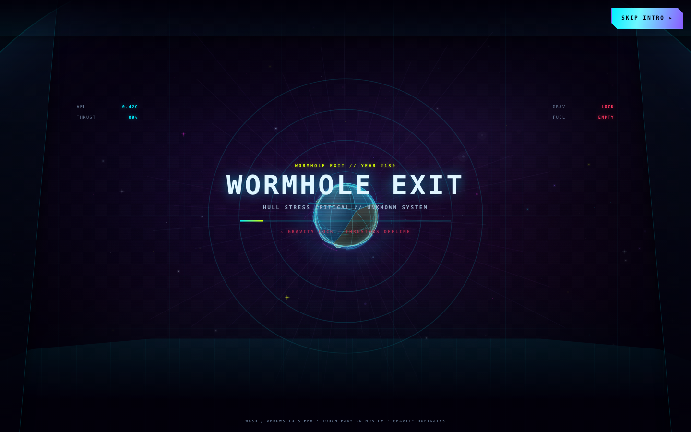
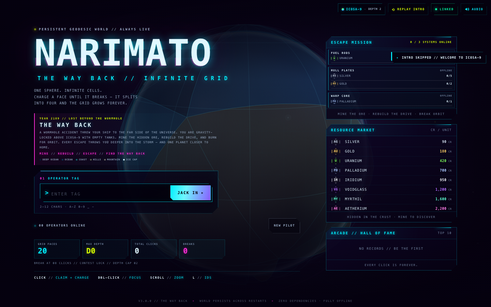
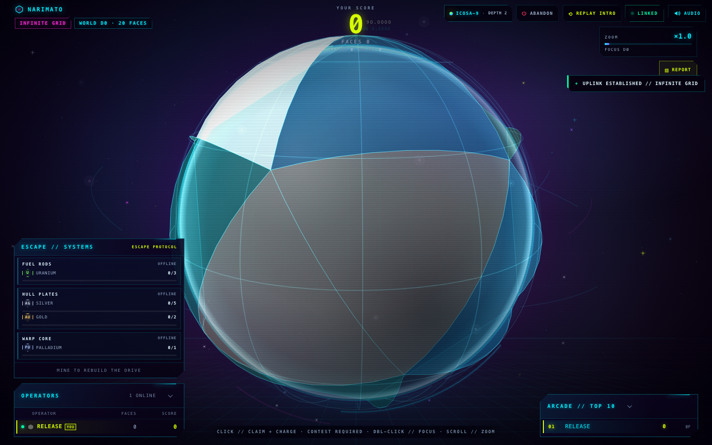
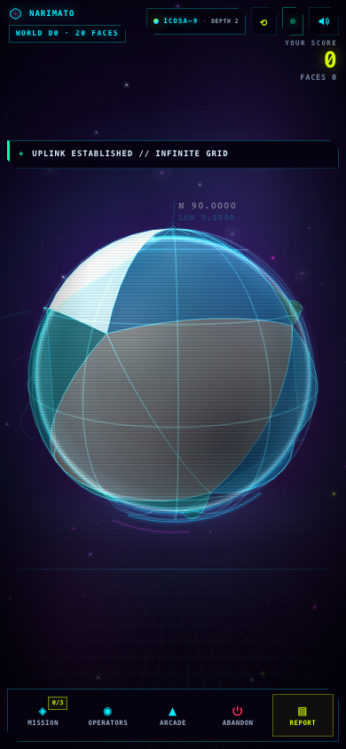
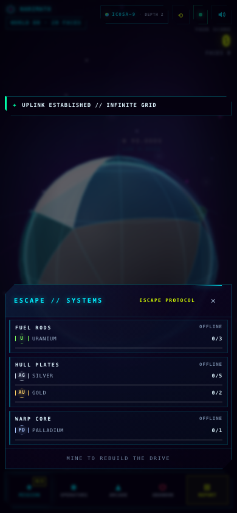
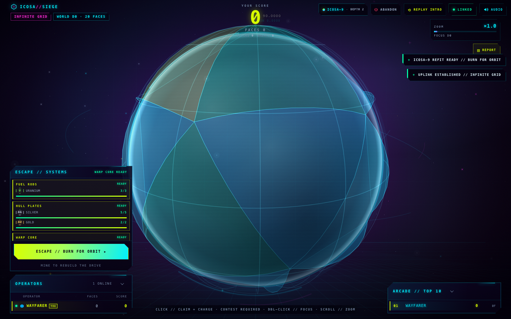
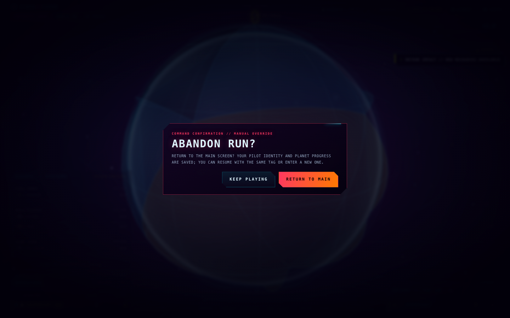
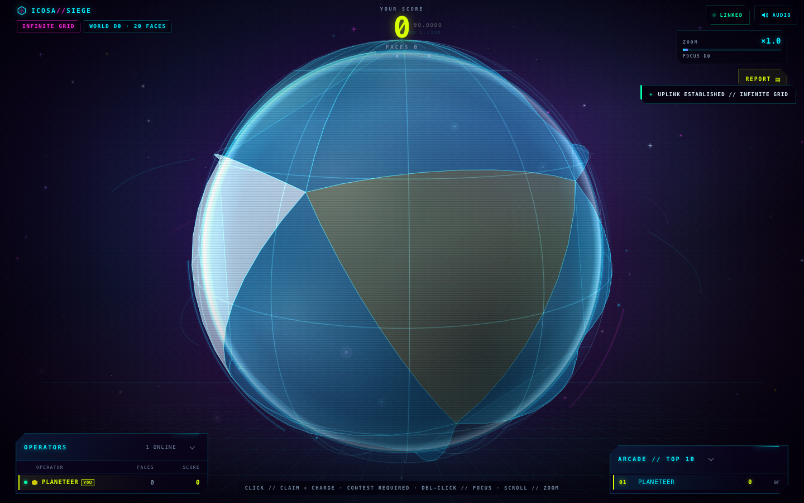

# NARIMATO


> **YEAR 2189. A wormhole throws your damaged ship to the far side of the universe.**
> You wake inside the cockpit above **ICOSA-9**, gravity-locked with empty tanks.
> Mine the crust, rebuild the drive, escape — and find the way home. Every escape throws you
> through a new story onto a new, deeper planet with its own multiplayer battlefield.

**NARIMATO** is a persistent multiplayer browser game on a spherical icosahedron. No installs,
no accounts, no build step, no external assets: join with a callsign and start mining.



## Play

```bash
npm start          # Node >= 20, zero dependencies
```

Open **http://localhost:4173** (LAN URL is printed on boot).

**Live:** https://treasurer-record-flooring-mounting.trycloudflare.com

### Controls

| Input | Action |
|---|---|
| **WASD / arrow keys / touch pads** | steer the cockpit during the wormhole intro |
| **Click / tap** a triangle | claim, steal or reinforce it and charge it |
| **Drag** | rotate the planet |
| **Wheel / pinch** | zoom from space to street level |
| **Double-click** | focus/drill into a cell |
| **L** | toggle all face ids (debug) |
| **REPORT** | session summary, downloadable PNG + share link |
| **ABANDON** | confirm and return to the main/tag screen |
| **NEW PILOT** (main screen) | clear this browser's saved pilot and start a new mission |
| **ESCAPE // BURN FOR ORBIT** | leave the planet once the refit is complete |

## The loop

1. **Launch cine** — every page load starts in the cockpit: wormhole exit, gravity lock,
   steerable descent, planet reveal. Skippable and replayable; it also acts as the loading screen.
2. **Tag in** — pick a callsign on the main screen. Each callsign is its own persistent identity
   with its own colour, score and planet progress.
3. **Mine** — charge triangles; a triangle individually breaks into four smaller spherical
   children at **4 clicks on the first planet** (8 on later planets). Hidden ore veins are mined on
   the first successful click and marked forever.
4. **Rebuild the drive** — the escape mission asks for specific ores; the HUD tracks every find.
5. **Escape** — when the refit is complete, burn for orbit. A random deep-space event (storm,
   pirates, wormhole tremor…) damages the ship and forces a landing on the **next planet**.
6. **Repeat forever** — planet 1 has **2 levels = 20 + 80 triangles**, planet 2 has **3 levels =
   20 + 80 + 320**, and so on up to the level cap. The first planet is a short tutorial with
   guaranteed refit ore; later planets are larger. Each planet is its own multiplayer scene with
   its own players, robots, leaderboard and grid.

Each planet has finite hidden deposits. When the planet is fully mined out, a **meteor impact**
resets its crust and releases new resources. The game never ends.

## Documentation

- [Gameplay guide](GAMEPLAY.md) — story, mission, planets, controls, tips.
- [Architecture](ARCHITECTURE.md) — stack, modules, protocols, data model, algorithms.
- [Release notes](RELEASE_NOTES.md) — what shipped in this release and migration notes.
- [Planet generation research](PLANET_RESEARCH.md) — low-data procedural surface sources/algorithm.
- [Algorithm notes](ALGORITHM.md) — spherical geometry, labels, picking, zoom math.
- [Protocol/feature specs](SPEC_INFINITE.md) · [resources](SPEC_RESOURCES.md) ·
  [planet surface](SPEC_PLANET.md) · [planet progression](SPEC_PLANETS.md).

## Features at a glance

- **Persistent spherical world** — adaptive four-way geodesic subdivision, stable hierarchical
  labels (`11.4`, `9.2.1.1`), individual per-cell breaking, infinite zoom.
- **Authoritative multiplayer** — Node server, SSE rooms per planet, robots on every planet,
  per-cell contest locks, atomic persistence, graceful restart recovery.
- **10 low-data biomes** — oceans, coasts, hills, mountains, peaks and both polar ice caps are
  generated from one 32-bit seed; no textures/heightmaps. Resources follow geology.
- **10 minerals** — silver → neutronium, hidden deposits, underwater deposits inaccessible.
- **Escape progression** — per-planet depth and scaled refit missions, random interplanetary
  story cinematics, screen shake/damage, separate multiplayer scene for every planet.
- **Meteor reset** — exhausted planets are reseeded with fresh resources.
- **Responsive command deck** — deliberately different desktop, tablet, mobile portrait and
  landscape phone layouts; mobile is planet-first with drawers/dock/target sheet.
- **Reports & sharing** — 1200×630 session card, shareable URL, all stats persisted.
- **Zero runtime dependencies**, all UI/audio/visuals generated in code.

## Screenshots

| | |
|---|---|
|  |  |
|  |  |
|  |  |
|  |  |

## Development

```
npm test                 # 66 tests, node:test, no dependencies
npm start                # serve on PORT (default 4173), DATA_DIR (default ./data)
npm run dev              # alias
```

Environment: `PORT`, `HOST`, `DATA_DIR`, `BREAK_CLICKS`, `MAX_DEPTH`, `BOTS`, `DEPOSIT_CHANCE`,
and the bot timing variables. See [ARCHITECTURE.md](ARCHITECTURE.md#configuration).

### Repository layout

```
server.js                 HTTP/SSE server + static files
lib/world-core.js         authoritative planet world, players, mining, persistence
lib/planet-manager.js     multi-planet rooms, routing, escape, meteor, stories
public/index.html         shell + intro/interlude/HUD markup
public/js/app.js          client integration + game loop
public/js/renderer.js     Canvas 2D spherical renderer
public/js/world.js        client adaptive tree
public/js/ui.js           responsive DOM UI controller
public/js/intro.js        cockpit launch cinematic
public/js/interlude.js    interplanetary transit + meteor cinematic
public/js/result-card.js  session report + share card
public/js/shared/         geometry, planets, resources, mission rules
test/                     node:test suites
media/                    screenshots used by docs
```

## Status

Version **3.0.1** · MIT-licensed community project by the NARIMATO crew. The live world is persistent;
server restarts preserve every loaded planet and the token→planet registry.
