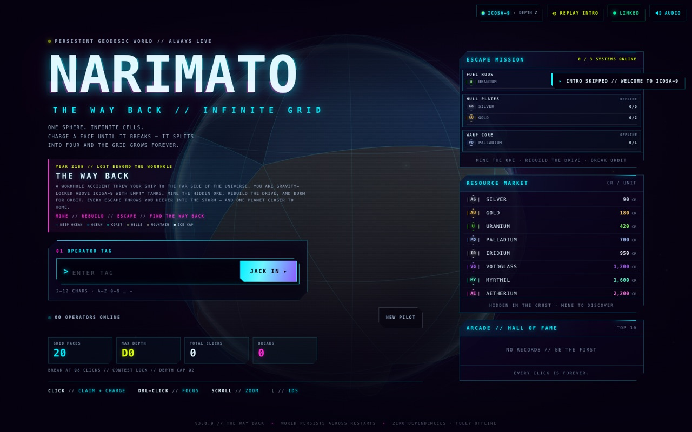
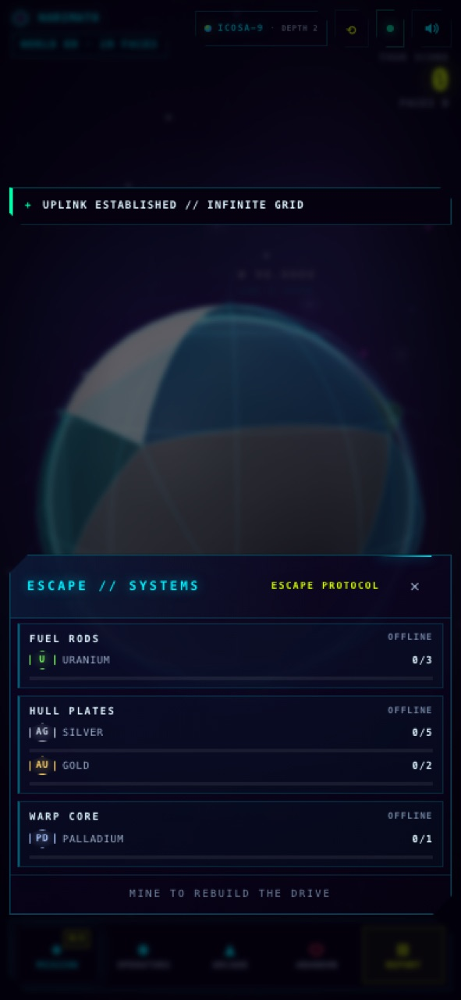
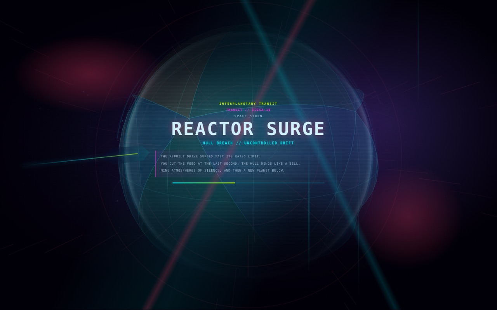
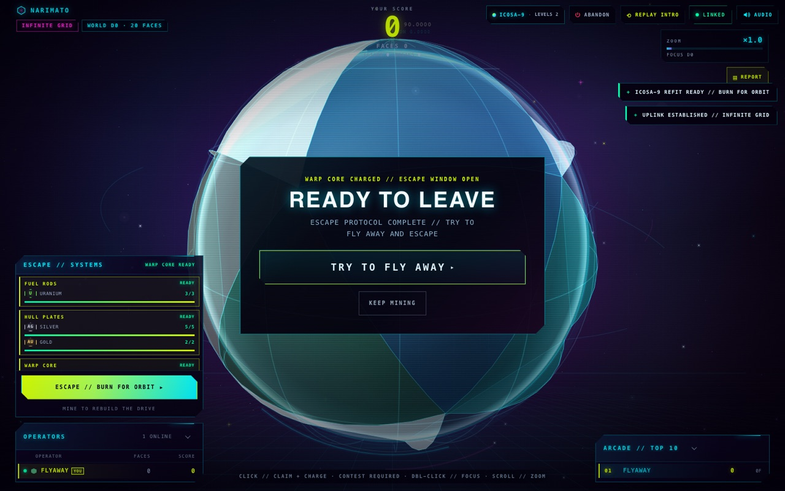
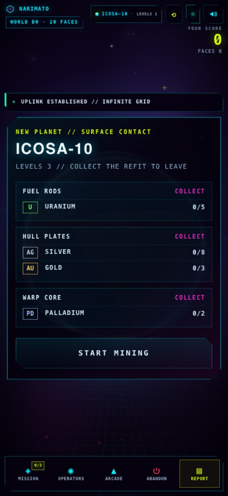

# NARIMATO


> **YEAR 2189. A wormhole throws your damaged ship to the far side of the universe.**
> You wake inside the cockpit above **MAGRATHEA**, gravity-locked with empty tanks.
> Mine the crust, rebuild the drive, escape — and find the way home. Every escape throws you
> through a new story onto a new, deeper planet with its own multiplayer battlefield.

**NARIMATO** is a persistent multiplayer browser game on a spherical icosahedron. No installs,
no accounts, no build step and no third-party runtime assets: join with a callsign and start mining.


## Play

```bash
npm start          # Node >= 20, zero dependencies
```

Open **http://localhost:4173** (LAN URL is printed on boot).

**Live:** https://treasurer-record-flooring-mounting.trycloudflare.com

### Controls

| Input | Action |
|---|---|
| **WASD / arrow keys / touch pads** | steer the cockpit during the wormhole intro |
| **Click / tap** a triangle | claim, steal or reinforce it and charge it |
| **Drag** | rotate the planet |
| **Wheel / pinch** | zoom from space to street level |
| **Double-click** | focus/drill into a cell |
| **L** | toggle all face ids (debug) |
| **REPORT** | session summary, downloadable PNG + share link |
| **ABANDON** | confirm and return to the main/tag screen |
| **NEW PILOT** (main screen) | clear this browser's saved pilot and start a new mission |
| **ESCAPE // BURN FOR ORBIT** | leave the planet once the refit is complete |

## The loop

1. **Launch cine** — every page load starts in the cockpit: wormhole exit, gravity lock,
   steerable descent, planet reveal. Skippable and replayable; it also acts as the loading screen.
2. **Tag in** — pick a callsign on the main screen. Each callsign is its own persistent identity
   with its own colour, score and planet progress.
3. **Mine** — charge triangles; a triangle individually breaks into four smaller spherical
   children at **4 clicks on the first planet** (8 on later planets). Hidden ore veins are mined on
   the first successful click and marked forever.
4. **Rebuild the drive** — the escape mission asks for specific ores; the HUD tracks every find.
5. **Escape** — when the refit is complete, burn for orbit. A random deep-space event (storm,
   pirates, wormhole tremor…) damages the ship and forces a landing on the **next planet**.
6. **Repeat forever** — planet 1 has **2 levels = 20 + 80 triangles**, planet 2 has **3 levels =
   20 + 80 + 320**, and so on up to the level cap. The first planet is a short tutorial with
   guaranteed refit ore; later planets are larger. Each planet is its own multiplayer scene with
   its own players, robots, leaderboard and grid.

Each planet has finite hidden deposits. When the planet is fully mined out, a **meteor impact**
resets its crust and releases new resources. The game never ends.

## Documentation

- [Gameplay guide](GAMEPLAY.md) — story, mission, planets, controls, tips.
- [Architecture](ARCHITECTURE.md) — stack, modules, protocols, data model, algorithms.
- [Release notes](RELEASE_NOTES.md) — what shipped in this release and migration notes.
- [Planet generation research](PLANET_RESEARCH.md) — low-data procedural surface sources/algorithm.
- [Algorithm notes](ALGORITHM.md) — spherical geometry, labels, picking, zoom math.
- [Protocol/feature specs](SPEC_INFINITE.md) · [resources](SPEC_RESOURCES.md) ·
  [planet surface](SPEC_PLANET.md) · [planet progression](SPEC_PLANETS.md).

## Features at a glance

- **Persistent spherical world** — adaptive four-way geodesic subdivision, stable hierarchical
  labels (`11.4`, `9.2.1.1`), individual per-cell breaking, infinite zoom.
- **Authoritative multiplayer** — Node server, SSE rooms per planet, robots on every planet,
  per-cell contest locks, atomic persistence, graceful restart recovery.
- **Detailed procedural geography** — a high-detail seeded terrain layer (continents, oceans,
  coasts, mountains, polar ice) renders behind the gameplay cells, so you see the planet surface
  through the grid. One 32-bit seed, no textures/heightmaps; resources follow the same geology.
- **10 minerals** — silver → neutronium, hidden deposits, underwater deposits inaccessible.
- **Escape progression** — per-planet levels and scaled refit missions, a centered
  **TRY TO FLY AWAY** call-to-action when the drive is ready, random interplanetary story
  cinematics, screen shake/damage, separate multiplayer scene for every planet.
- **Planetary incidents** — exhausted planets now end with one of four random catastrophes:
  **Meteor Impact**, **Nuclear War**, **Solar Flare** or **Alien Invasion**, each with its own
  full-screen effect, narration and reseeded crust, then fresh resources.
- **Responsive command deck** — deliberately different desktop, tablet, mobile portrait and
  landscape phone layouts; mobile is planet-first with drawers/dock/target sheet.
- **Inertial camera** — drag-spin the planet and release: it coasts longer with an ease-out curve
  and slowly comes to rest; wheel/pinch zoom eases into its target instead of snapping.
- **Narration & subtitles** — slow, deliberate prerecorded voice-over delivered **one sentence at
  a time**, with a short pause between lines, for the story, tips, Field Manual and every
  interplanetary story. **VOICE** and **CC** toggle independently and remember your choice;
  subtitles work even when autoplay blocks the first audio line.
- **Three narrator voices** — open-source **GEORGE** (Kokoro-82M, default), British **DANIEL** or US
  **SAMANTHA**, selectable in the Field Manual. See [VOICE.md](VOICE.md) for the voice pipeline and
  open-source TTS options (Kokoro, Piper).
- **Narration load management** — first sentences are idle-prefetched with limited concurrency,
  the next sentence is warmed while the current one plays, and voice assets are versioned and
  cached immutably, so sentence transitions do not stall on the network.
- **Field Manual** — an in-game guide to the story, mining, contest lock, planets, navigation and
  controls, with a PLAY button on each section.
- **Contextual tips** — one-time narrated hints for first mining, red locked cells, ore discovery,
  escape readiness, new planets and meteor resets.
- **Navigation target** — a gold **NAV** beacon and chip point to the best nearby geological cell
  to mine; tap the chip to fly the camera there or ↻ to cycle targets.
- **Red locked cells** — a cell you just mined turns red until another operator contests it; then
  it clears and you can mine again.
- **Procedural refit missions** — every planet generates its own requirements from its seed. Planet 1
  starts minimal (3 units); each deeper planet grows the refit by 0–3 units and mixes in different
  materials, so no two planets ask for the same cargo.
- **Full cargo inventory** — the HUD shows every collected material, including surplus beyond the
  current refit needs. Everything travels with you to the next planet.
- **Random destinations** — an escape sends you to one of the next **five** planets chosen at random,
  never backwards, each with its own mission and scene.
- **A galaxy of borrowed worlds** — planet names are drawn from a curated cultural catalog
  (*Hitchhiker's Guide*, Star Wars, Marvel, DC, Dune, Doctor Who, Star Trek, Alien, Avatar,
  Foundation, Transformers, classic myth and more) with the source shown in the landing briefing
  and planet tooltip.
- **Random discovery clicks** — each hidden deposit is found on a random successful click (first,
  middle or the break/last click), not always on the very first click.
- **First-planet briefing** — the centered "collect to leave" list now appears on the very first
  planet too, not only after interplanetary landings.
- **Dynamic staffing** — every active planet keeps **3 players online**: 1 human + 2 robots,
  2 humans + 1 robot, or 3+ humans and no robots; replacements spawn immediately.
- **Landing briefing** — touching down on a new planet opens a centered card listing exactly which
  ores are needed to leave, with collected/required counts.
- **Reports & sharing** — 1200×630 session card, shareable URL, all stats persisted.
- **Zero runtime dependencies**, all UI/audio/visuals generated in code.

## Screenshots

| | |
|---|---|
|  |  |
|  |  |
|  |  |
|  |  |
|  |  |
|  |  |
|  |  |  |
|  |  |
|  |  |

## Development

```
npm test                 # 66 tests, node:test, no dependencies
npm start                # serve on PORT (default 4173), DATA_DIR (default ./data)
npm run dev              # alias
```

Environment: `PORT`, `HOST`, `DATA_DIR`, `BREAK_CLICKS`, `MAX_DEPTH`, `BOTS`, `DEPOSIT_CHANCE`,
and the bot timing variables. See [ARCHITECTURE.md](ARCHITECTURE.md#configuration).

### Repository layout

```
server.js                 HTTP/SSE server + static files
lib/world-core.js         authoritative planet world, players, mining, persistence
lib/planet-manager.js     multi-planet rooms, routing, escape, meteor, stories
public/index.html         shell + intro/interlude/HUD markup
public/js/app.js          client integration + game loop
public/js/renderer.js     Canvas 2D spherical renderer
public/js/world.js        client adaptive tree
public/js/ui.js           responsive DOM UI controller
public/js/intro.js        cockpit launch cinematic
public/js/interlude.js    interplanetary transit + meteor cinematic
public/js/result-card.js  session report + share card
public/js/shared/         geometry, planets, resources, mission rules
test/                     node:test suites
media/                    screenshots used by docs
```

## Status

Version **3.8.1** · MIT-licensed community project by the NARIMATO crew. The live world is persistent;
server restarts preserve every loaded planet and the token→planet registry.
