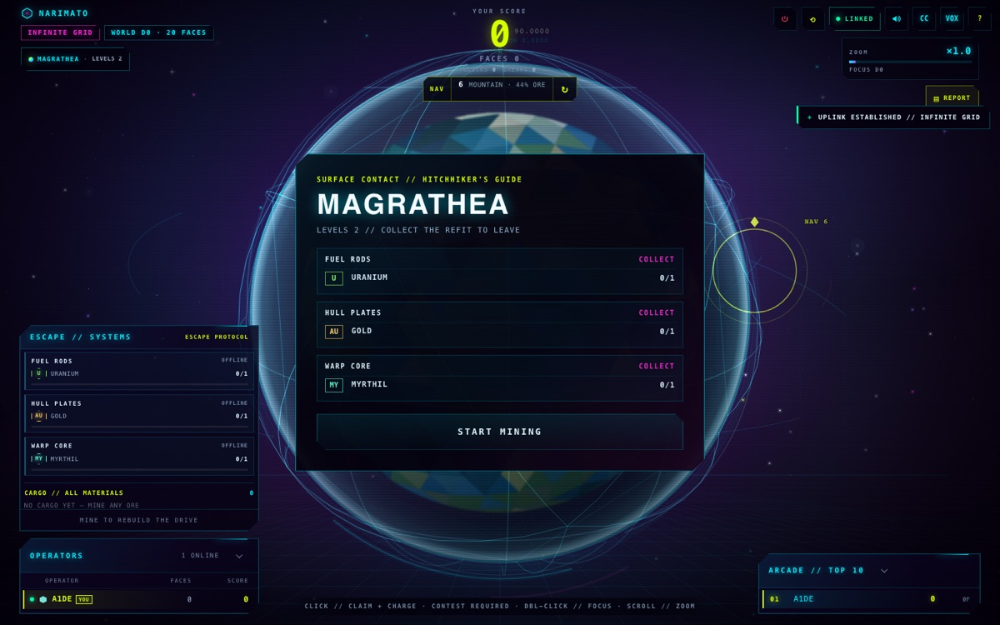

# NARIMATO — Elephant–Goldfish UX Audit

<!-- delivery-ssot:start -->
> **Delivery SSOT:** [NARIMATO delivery board](https://github.com/users/moldovancsaba/projects/80) · [Definition of Done](docs/DEFINITION_OF_DONE.md) · [Issue index](docs/ISSUE_MAP.md).
> This document owns durable knowledge; it does not track delivery status.
>
> **Related delivery issues:** [UI-02](https://github.com/moldovancsaba/narimato/issues/8) · [A11Y-02](https://github.com/moldovancsaba/narimato/issues/13)
<!-- delivery-ssot:end -->

**Date:** 2026-11-18 · **Build:** v3.8.0 · **Method:** headless Chromium, fresh throwaway
world, nine viewports (1440×900, 1280×800, 1024×768, 900×600, 792×600, 844×390,
792×302, 390×844, 360×740), full landing → intro → join → HUD → mission → target →
manual → escape CTA → report flow.

> **Elephant** = big, unmissable breakage that blocks reading/playing.
> **Goldfish** = what a new player fails to understand in the first five seconds.

## Remediation status — v3.8.1

A0–A2 from the delivery plan are now implemented and verified with
`scripts/audit-ui.mjs` (all nine viewports clean):

- **E1 fixed:** planet identity moved out of the action cluster into the brand;
  secondary actions are icon-only. Score/nav/badge intersections are 0 at all
  audited widths, and NAV now sits below the score.
- **E2 fixed:** landing briefing card is viewport-capped and scrollable; START
  MINING is reachable at 792×302.
- **E3 fixed:** escape CTA card is viewport-capped and scrollable.
- **E4 fixed:** `body.has-target` raises the subtitle safe zone above the target
  inspector (0 px overlap across the matrix).
- **E5 fixed:** intro captions move clear of steering on portrait and the steer
  pads are hidden on very short viewports; caption/steer overlap is 0.
- **E6 fixed:** Field Manual reserves bottom space for captions.
- **E7/E8 partially addressed:** compact icon row and moved planet identity reduce
  crowding; short landing join still needs the A3 hierarchy pass.
- **A3 delivered (v3.9.0):** mobile media controls now have visible labels and 44 px touch
  targets; a `TAP FOR VOICE` hint appears until the first gesture unlocks autoplay; the landing
  screen hides in-game chrome and uses a two-column short-landscape layout so JACK IN stays
  on-screen. The A0 harness now asserts labels, 44 px targets, accessible button names and
  short-landing visibility.
- **A4 partially delivered:** Escape closes manual/brief/CTA; accessible-name and 44 px checks
  are in the harness. Real iOS Safari/Android and screen-reader passes remain a manual gate.
- **B0 delivered:** `/api/metrics`, privacy-safe `/api/telemetry`, client beacon and
  `OBSERVABILITY.md`; see Track B below.



## Summary

The game is functional and console-clean, but the **top HUD is not layout-safe at any
desktop/tablet width** once the narration controls and longer planet names are present.
Overlay stacking is the second systemic issue: subtitles sit above panels they should
never cover, and two critical overlays cannot be dismissed on short screens.

All findings below are reproducible on the current build; no server errors or horizontal
page overflow were observed.

---

## Elephants — P0 / P1

### E1. Planet badge + status row covers the score (all desktop/tablet sizes) — P0

At 1440×900:

| element | measured rect |
|---|---|
| `#planet-badge` | x 599.8–757.1, y 10–44 |
| `#hud-score` | x 620–820, y 10–107 |
| `#nav-chip` | x 609–831, y 62–98 |
| status cluster | x 599.8–1428, y 10–44 |

The planet badge sits directly over `YOUR SCORE`, and the NAV chip covers the lower half
of the score. The status cluster is now ~828 px wide because every media control
(`ABANDON`, `REPLAY INTRO`, `LINKED`, `AUDIO`, `CC`, `VOX`, `?`) is label-width, so its
left edge reaches into the centered score. The same collision occurs at 1280 and 1024.
This is the user-supplied screenshot: `NAV 8.2 · MOUNTAIN` / `MAGRATHEA · LEVELS 2` over
the score digits.

**Evidence:** `media/audit/hud-overlap.jpg`, `media/audit/landscape-hud.jpg`

### E2. Landing briefing cannot be dismissed on short screens — P0

At 792×302 (also 844×390 for the bottom of the button):

- brief card is taller than the viewport;
- `#btn-landing-brief-start` is at y 311–363 on a 302 px viewport;
- `.landing-brief` has `overflow: visible`; body is `overflow: hidden`; wheel/scroll
  does nothing;
- the player arrives on a new planet and **cannot press START MINING**.

**Evidence:** `media/audit/brief-clipped.jpg`

### E3. Escape CTA is cut off on short viewports — P0/P1

At 792×302 the escape card bottom is y 330 > 302, so the primary
`TRY TO FLY AWAY` action is off-screen. The CTA has no scroll container either.
At 844×390 it fits, but this depends on the mission text; it needs the same
scroll-safe treatment as E2.

### E4. Subtitles cover the target inspector — P0

When a cell is hovered/selected:

| viewport | target panel | subtitle bar |
|---|---|---|
| desktop 1440 | y 737–850 | y 773–816 |
| mobile 390 | y 672–772 | y 721–758 |

The subtitle bar is `z-index: 98`, the target panel is informational content beneath it.
The selected cell's terrain/charge/lock data is unreadable exactly when the player needs it.

**Evidence:** `media/audit/target-subtitle.jpg`

### E5. Intro subtitles cover the mobile touch-steering pads — P0

On 390×844:

- intro subtitle: y 721–758;
- steering pad grid: y 656–824.

On 792×302 the same collision is y 179–218 vs y 142–292. Captions overlay the touch
controls, so reads and touch input compete for the same pixels.

**Evidence:** `media/audit/intro-steer.jpg`

### E6. Field Manual content is covered by the subtitle bar — P1

With narration active and the manual open on 390×844, the subtitle bar overlays the
manual card's text (screenshot shows the lower “CONTEST LOCK & ROBOTS” text behind the
TACTICAL caption). The manual is a scrollable modal; captions need reserved space inside
it, or a transcript placement that does not cover content.

**Evidence:** `media/audit/manual-subtitle.jpg`

### E7. Mobile / landscape HUD row is overcrowded — P1

At 390 px the status/planet row reaches x 40–382, while the score occupies x 321–380.
The `WORLD D0 · 20 FA…` chip truncates. At 844×390 the same row spans nearly the full
width and the score/abandon labels are clipped. The controls are icon-only at mobile
(CC/VOX/? have no visible words), which adds discovery cost.

**Evidence:** `media/audit/mobile-hud.jpg`, `media/audit/landscape-hud.jpg`

### E8. Landing join form sits below the fold on short screens — P1

On 792×302 and 844×390 the JACK IN form starts below the viewport; the landing overlay is
scrollable, but the primary action is not visible on first paint. This is a goldfish
problem on tablets/landscape phones.

---

## Goldfish — first-five-seconds clarity

1. **Score priority is inverted.** The most important live number is the one hidden
   behind the planet badge/pills.
2. **Top-right controls are a flat wall.** `ABANDON`, `REPLAY INTRO`, `AUDIO`, `CC`,
   `VOX`, `?` all look equally important; no grouping or overflow menu.
3. **Mobile icon meanings are not discoverable.** `CC` / `VOX` / `?` rely on hover
   tooltips on touch devices. They need labels or a settings sheet.
4. **NAV chip appears before the player knows the game.** The chip overlaps the score
   and reads `8 · MOUNTAIN · 44% ORE` before there is context for what “8” means.
5. **Planet identity is treated as a control.** `MAGRATHEA · LEVELS 2` sits in the
   action cluster; it reads like a button and competes with the score.
6. **Autoplay narration has no visible state.** Browsers block audio until a gesture;
   the subtitle appears, but there is no “voice starts on tap” cue.
7. **Landing CTA can be below the fold** (E8) and the short-screen briefing can trap
   the player (E2).
8. **Duplicate mission surfaces** (`ESCAPE // SYSTEMS` panel + landing briefing) are
   fine once in flow, but the briefing is unreadable at short heights.
9. **Touch target sizes:** status media buttons are ~32 px, below the 44 px recommended
   minimum; intro steer pads are 52 px.
10. **Source attribution only in tooltip/ARIA**; the planet universe reference is not
    visible in the HUD without hovering.

---

## Consistency / content checks

- Dynamic planet names/source are wired through server state, HUD, intro and landing:
  `MAGRATHEA // HITCHHIKER'S GUIDE` renders correctly.
- Old `ICOSA-*` strings remain only in comments/historical release notes and test
  fixtures; no live UI fallback still uses them.
- Console errors: **none** in the audited flows. No horizontal document overflow.
- Audio assets: versioned immutable cache works; 28 first-sentence requests at idle.
- Mobile report: content height 998 px > 844 px but report overlay scrolls; short
  report needs a dedicated check with long reports.
- No evidence of mission/cargo count mismatch in the audited state; excess ore is shown
  in the Cargo panel.

## Audit limitations

Headless Chromium at simulated viewports; no real iOS Safari/Android device, no
screen-reader pass, no hearing check of voice quality. The audio load timings are local,
not through a consumer network. Real devices, screen readers and throttled networks remain a
separate gate: [docs/DEVICE_GATE.md](docs/DEVICE_GATE.md) defines the fixed matrix and the
commit-keyed evidence ledger; this audit does not sign it.

## Repro

Use a fresh world (do not touch production data):

```sh
PORT=4390 HOST=127.0.0.1 DATA_DIR=/tmp/narimato-audit BOTS=0 node server.js
# then run Playwright at the nine viewports listed above
```

## Suggested severity order

1. E1 score/HUD collision
2. E2/E3 blocked overlays
3. E4/E5/E6 subtitle stacking
4. E7/E8 responsive hierarchy
5. Goldfish items 1–6

## UI-02…UI-05 follow-up (GDS migration)

- **E1 — planet badge over score:** resolved. The badge and score are separate GDS panels in the
  responsive top strip; the planet name truncates with the full value in an accessible label.
- **E4 — 32 px status controls:** resolved. Status and dock controls render as GDS buttons with a
  44 px minimum target; the dock scrolls/wraps instead of shrinking labels.
- **E7 — crowded mobile rows:** resolved. Panels become drawers on compact layouts and the status
  row scrolls horizontally; operator/mission rows are stacked GDS rows with a text status.
